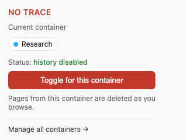
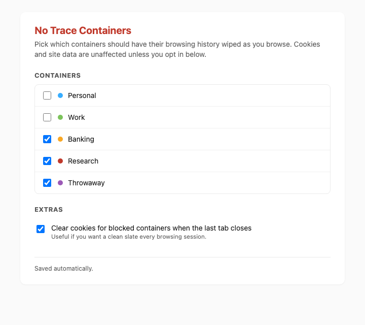

# No Trace Containers

[](https://addons.mozilla.org/firefox/addon/no-trace-containers/)
[](https://addons.mozilla.org/firefox/addon/no-trace-containers/)
[](https://addons.mozilla.org/firefox/addon/no-trace-containers/reviews/)
[](LICENSE)
[](https://github.com/ziki17/no-trace-containers)

A Firefox extension that disables browsing history for chosen Multi-Account Containers. Optionally clears cookies for those containers when their last tab closes.

> Built because [`xieve/no-history-containers`](https://gitlab.com/xieve/no-history-containers) is unmaintained and was broken on recent Firefox.

<p align="center">
  
  &nbsp;&nbsp;
  
</p>

> Screenshots above are renders of the actual extension UI with sample container names. Your containers will appear with their real names and colors.

## Install

**From AMO (recommended):** [addons.mozilla.org/firefox/addon/no-trace-containers](https://addons.mozilla.org/firefox/addon/no-trace-containers/) — one click, auto-updates, signed.

For developer / temporary install from source, see [below](#install-developer--temporary).

## What it does

- Pick which Firefox containers should leave no browsing history.
- Pages opened in those containers are removed from history as you browse and again when the tab closes.
- (Optional) When the last tab of a marked container closes, its cookies are wiped too.
- Default container and non-container tabs are never touched.

## Why not just use…?

| Alternative | What it does | Why this is different |
| --- | --- | --- |
| **Private Browsing** | Whole window has no history, but no persistent logins anywhere. | This extension keeps your persistent logins (work, banking) and only kills history for the containers you mark. |
| **Temporary Containers** extension | Auto-creates throwaway containers per tab. | Great companion — but it doesn't delete history. Use both together. |
| **"Clear history on close" Firefox setting** | Wipes everything on quit. | Wipes too much. Loses your normal browsing history along with the sensitive stuff. This extension is surgical: per-container, real-time. |
| **Manual history delete** | One-off cleanup. | Easy to forget; URLs already leaked into awesomebar/sync before you remember. This extension deletes as you browse, before the suggestion engine sees them. |

## Privacy

- **Zero network requests.** The extension never connects to any server.
- **Zero telemetry, zero analytics, zero ads.**
- All processing is local. Settings live in `browser.storage.local` on your machine only.
- The source is ~400 lines of hand-written JS — auditable in one sitting.

See the [permissions table](#permissions-explained) for exactly why each permission is requested.

## Requirements

- Firefox **142** or newer.
- Container Tabs enabled: `about:preferences#tabs` → **Enable Container Tabs**.
- "Remember history" mode (the extension cannot work in always-private-browsing mode — there is no history to delete).

Works on Firefox-based browsers too: **LibreWolf, Floorp, Zen, Waterfox** — anywhere `browser.contextualIdentities` is exposed.

## Install (developer / temporary)

1. Clone this repo.
2. In Firefox, open `about:debugging#/runtime/this-firefox`.
3. Click **Load Temporary Add-on…** and pick the `manifest.json` in the project root.
4. Click the extension icon → **Manage all containers** → check the containers you want history disabled for.

Temporary add-ons disappear when Firefox restarts. For a persistent install, use the [AMO version](https://addons.mozilla.org/firefox/addon/no-trace-containers/) or sign your own xpi via [Mozilla's self-distribution flow](https://extensionworkshop.com/documentation/publish/self-distribution/).

## Build a packaged `.xpi`

```bash
npm install
npm run build
# Produces web-ext-artifacts/no_trace_containers-<version>.zip — that file is a valid .xpi.
```

## Develop

```bash
npm install
npm run start    # launches a fresh Firefox profile with the extension loaded
npm run lint     # runs web-ext lint
```

## How it works

Firefox writes to its history DB asynchronously. To avoid races, this extension deletes the URL at three points:

1. **`webNavigation.onCommitted`** — as soon as Firefox knows the URL.
2. **`webNavigation.onCompleted`** — after the page finishes loading.
3. **`tabs.onRemoved`** — one final pass when the tab closes.

Container membership is determined via `tab.cookieStoreId` and looked up against your saved settings (`browser.storage.local`). If the container is marked, every committed/completed URL on that tab is fed to `history.deleteUrl`.

Cookie wipe (opt-in) listens for `tabs.onRemoved`, checks if any other tabs from that cookieStoreId remain, and if not, enumerates cookies via `cookies.getAll({ storeId })` and removes them.

## Permissions explained

| Permission             | Why                                                             |
| ---------------------- | --------------------------------------------------------------- |
| `history`              | Delete URLs from history for marked containers                  |
| `tabs`                 | Inspect a tab's `cookieStoreId` (which container it belongs to) |
| `webNavigation`        | Detect when a page commits/completes to delete its history      |
| `contextualIdentities` | Enumerate containers in the options page                        |
| `cookies`              | Clear container cookies on tab close (only if you opt in)       |
| `storage`              | Persist your settings                                           |
| `<all_urls>`           | Required for `history.deleteUrl` to apply to any site           |

## FAQ

**Does it sync via Firefox Sync?**
No. Settings live in `browser.storage.local`, which is per-device by design. If you want sync, open an issue — it's a one-line switch to `browser.storage.sync` but the API is rate-limited and small.

**Does it work with the Temporary Containers extension?**
Yes — they're complementary. Temporary Containers creates a fresh container per tab; this extension wipes the history those containers generate.

**Does it affect bookmarks or downloads?**
No. Only `history` entries. Bookmarks, downloads, and form autofill are untouched.

**Does it affect `places.sqlite` session restore?**
No. Session restore uses a separate store. If you close a marked-container tab and reopen via Ctrl+Shift+T, the tab comes back — but no history entry was written.

**What about sub-resource URLs (images, scripts, iframes)?**
Firefox doesn't write sub-resources to the visible history DB, so this isn't usually an issue. Top-level navigations are what `awesomebar` and the History panel surface.

**Does it work in Private Browsing windows?**
By design, no. Private windows write no history, so there's nothing to delete. Also, the extension is not granted access to private windows by default — toggle it on under `about:addons` if you want it loaded in private mode.

**I marked a container but old history is still there.**
This extension only deletes pages opened *after* you marked the container. To clean previously-recorded history, use Firefox's History → Search → search the container's typical sites → delete.

## Known limitations

- History deletion races with Firefox's history writer. Three-phase deletion handles 99%+, but exotic redirects can occasionally slip a URL through.
- Does not affect downloaded files or bookmarks.
- "Always use private browsing" mode bypasses this extension by design.

## Support

Found a bug? Have a feature request?

- **Bugs:** [open an issue](https://github.com/ziki17/no-trace-containers/issues)
- **Reviews / praise:** [leave a rating on AMO](https://addons.mozilla.org/firefox/addon/no-trace-containers/reviews/) — helps discoverability

## Changelog

See [CHANGELOG.md](CHANGELOG.md).

## License

MIT — see [`LICENSE`](LICENSE).

## Contributing

Issues and PRs welcome. Keep changes minimal — the goal is a small, dependable extension, not a feature pile.

---

If this extension is useful to you, **[star the repo](https://github.com/ziki17/no-trace-containers)** and **[leave a review on AMO](https://addons.mozilla.org/firefox/addon/no-trace-containers/reviews/)**. Both push the extension up in search rankings, which is how more people find it.
